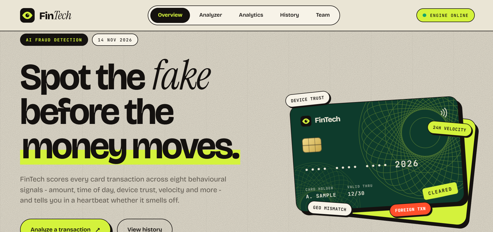
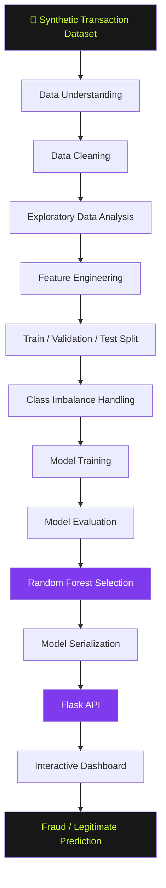
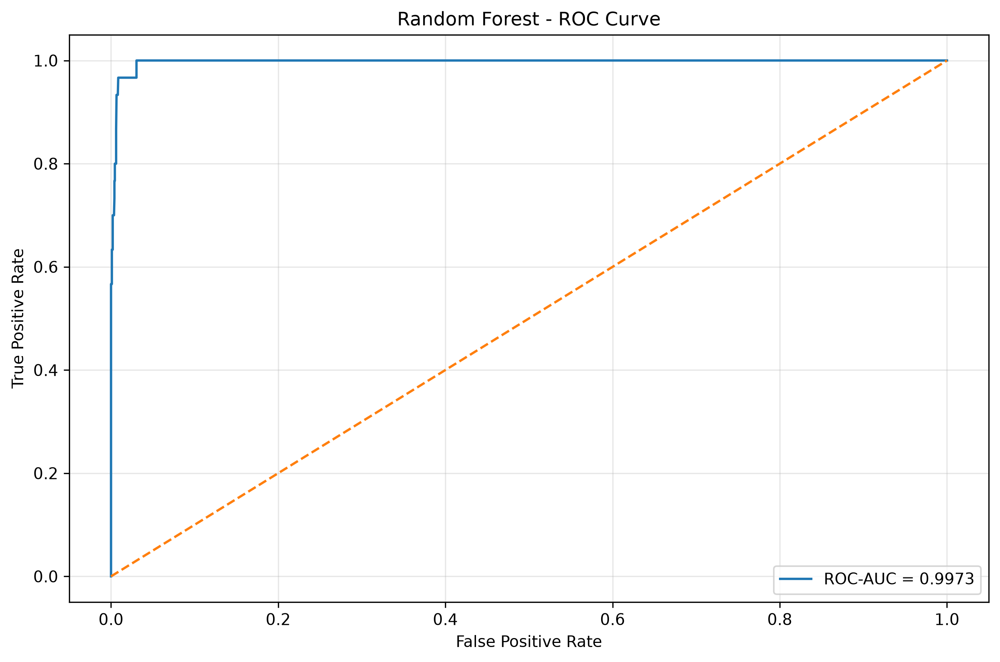
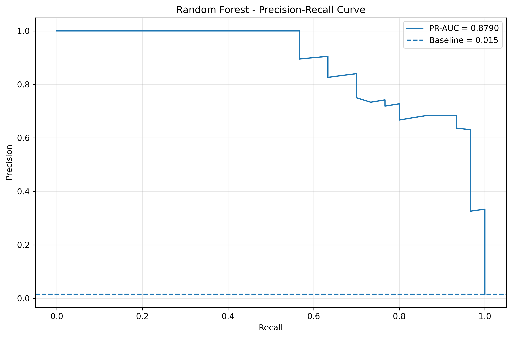

<div align="center">

# 💳 FinTech
### Intelligent Credit Card Fraud Detection System

**Detect suspicious transactions using Machine Learning.**

A machine learning-powered web application that analyzes transaction characteristics and identifies potentially fraudulent credit card transactions using a trained Random Forest classifier.

<br>

[](https://fintech-fraud-detection-4ryk.onrender.com)
[](https://github.com/PritwishSaha/FinTech)
[](https://www.python.org/)
[](https://flask.palletsprojects.com/)
[](https://scikit-learn.org/)

<br>

**Built with Python · Scikit-learn · Pandas · NumPy · Flask · HTML · CSS · JavaScript**

</div>

---

## 🌐 Live Application

<div align="center">

### Experience the deployed application

**[https://fintech-fraud-detection-4ryk.onrender.com](https://fintech-fraud-detection-4ryk.onrender.com)**

</div>

The application provides an interactive dashboard where users can submit transaction details and receive machine learning-based fraud predictions.

---

## 📸 Application Preview

<div align="center">

<!-- Replace this path with your actual dashboard screenshot -->



*FinTech – Credit Card Fraud Detection Dashboard*

</div>

> **Note:** Add your dashboard screenshot at `docs/screenshots/dashboard.png` or update the image path above.

---

## ✨ Key Features

| Feature | Description |
|---|---|
| 🔍 Fraud Detection | Predicts whether a transaction is potentially fraudulent or legitimate. |
| 🤖 Machine Learning | Uses a trained Random Forest classification model. |
| 📊 Interactive Dashboard | Displays transaction predictions and session analytics. |
| ⚡ Real-Time Inference | Generates predictions through a Flask REST API. |
| 🛡️ Input Validation | Validates transaction details before model inference. |
| 📈 Risk Score | Displays the model's fraud score for each transaction. |
| 📋 Transaction History | Maintains recent predictions during the current browser session. |
| ☁️ Cloud Deployment | Hosted using Render. |
| 📱 Responsive Interface | Provides a responsive frontend for different screen sizes. |

---

## 🧠 Machine Learning Workflow

The project follows an end-to-end machine learning workflow.



### 1. Dataset Overview

The project uses a synthetic credit card transaction dataset containing **10,000 transactions**.

| Attribute | Value |
|---|---:|
| Total Transactions | 10,000 |
| Total Features | 10 |
| Legitimate Transactions | 9,849 |
| Fraudulent Transactions | 151 |
| Legitimate Percentage | 98.49% |
| Fraud Percentage | 1.51% |
| Missing Values | 0 |
| Duplicate Records | 0 |

### 2. Dataset Features

| Feature | Description |
|---|---|
| `transaction_id` | Unique transaction identifier |
| `amount` | Transaction amount |
| `transaction_hour` | Hour when the transaction occurred |
| `merchant_category` | Merchant category |
| `foreign_transaction` | Indicates whether the transaction is foreign |
| `location_mismatch` | Indicates a location mismatch |
| `device_trust_score` | Device trust score |
| `velocity_last_24h` | Transaction activity during the last 24 hours |
| `cardholder_age` | Cardholder age |
| `is_fraud` | Target variable (0 = Legitimate, 1 = Fraud) |

### 3. Feature Engineering

The transaction hour was transformed into cyclical features to represent the circular nature of time.

- `hour_sin`
- `hour_cos`

The transaction identifier was excluded from model training.

**Final feature count: 9**

### 4. Handling Class Imbalance

The dataset contains significantly fewer fraudulent transactions than legitimate transactions.

To address this imbalance, the project uses:

**SMOTENC – Synthetic Minority Over-sampling Technique for Nominal and Continuous Features**

SMOTENC was applied only to the training portion of the data. Validation and test datasets remained unchanged.

### 5. Machine Learning Models

The following classification models were evaluated:

- Random Forest Classifier
- Logistic Regression
- Tuned Random Forest Classifier

The original Random Forest model was selected based on its validation F1-score.

---

## 📊 Model Performance

### Final Test Set Evaluation

| Metric | Score |
|---|---:|
| Accuracy | 99.20% |
| Precision | 71.88% |
| Recall | 76.67% |
| F1-Score | 74.19% |
| ROC-AUC | 99.73% |
| Average Precision | 87.90% |

### Confusion Matrix

| Actual / Predicted | Legitimate | Fraud |
|---|---:|---:|
| Legitimate | 1961 | 9 |
| Fraud | 7 | 23 |

### Model Configuration

| Parameter | Value |
|---|---|
| Selected Model | Random Forest Classifier |
| Decision Threshold | 0.50 |
| Random State | 42 |
| Training Records | 8,000 |
| Validation Records | 2,000 |
| Testing Records | 2,000 |
| Fraud Cases in Test Set | 30 |

**Important:** Accuracy alone is not sufficient for fraud detection. Precision, recall, F1-score, ROC-AUC, and Average Precision are also considered because the dataset is highly imbalanced.

The evaluation results are based on this synthetic dataset and should not be interpreted as expected performance on real banking transactions.

---

## 🛠️ Technology Stack

### Programming & Data Processing


### Machine Learning


### Backend & Frontend


### Deployment & Development


---

## 📁 Project Structure

```text
FinTech/
│
├── app.py
├── requirements.txt
├── README.md
│
├── data/
│   └── credit_card_fraud_10k.csv
│
├── notebooks/
│   └── credit_card_fraud_detection.ipynb
│
├── models/
│   ├── final_fraud_detection_model.pkl
│   └── model_metadata.json
│
├── reports/
│   ├── feature_importance_report.csv
│   └── model_comparison_report.csv
│
├── visualizations/
│   ├── roc_curve.png
│   └── precision_recall_curve.png
│
├── templates/
│   └── index.html
│
├── static/
│   ├── css/
│   │   └── style.css
│   │
│   ├── js/
│   │   └── script.js
│   │
│   └── images/
│
└── .gitignore
```

---

## ⚙️ Installation & Local Setup

Follow these steps to run the project locally.

### 1. Clone the Repository

```bash
git clone https://github.com/PritwishSaha/FinTech.git
```

### 2. Navigate to the Project Directory

```bash
cd FinTech
```

### 3. Create a Virtual Environment

```bash
python -m venv .venv_fraud
```

### 4. Activate the Environment

**Windows PowerShell:**

```powershell
.\.venv_fraud\Scripts\Activate.ps1
```

### 5. Install Dependencies

```bash
pip install -r requirements.txt
```

### 6. Run the Flask Application

```bash
python app.py
```

### 7. Open in Your Browser

```text
http://127.0.0.1:5000
```

---

## 🔌 API Documentation

The application provides REST API endpoints for application status and transaction prediction.

### 1. Health Check

**Endpoint:**

```http
GET /health
```

Checks the application and model loading status.

### 2. Fraud Prediction

**Endpoint:**

```http
POST /predict
```

**Content-Type:**

```http
application/json
```

**Example Request:**

```json
{
    "amount": 1250.50,
    "transaction_hour": 2,
    "merchant_category": "Electronics",
    "foreign_transaction": 1,
    "location_mismatch": 1,
    "device_trust_score": 28,
    "velocity_last_24h": 7,
    "cardholder_age": 25
}
```

**Example Response:**

```json
{
    "prediction": 1,
    "status": "FRAUD",
    "fraud_probability": 0.825,
    "threshold": 0.5,
    "model": "Random Forest"
}
```

*The response is illustrative. Actual predictions depend on the model and submitted transaction features.*

### Prediction Interpretation

| Prediction | Meaning |
|---|---|
| `0` | Legitimate Transaction |
| `1` | Potentially Fraudulent Transaction |

The displayed fraud score is the Random Forest model's raw predicted score. It is not a calibrated estimate of real-world fraud probability.

---

## 📈 Model Evaluation Visualizations

The project includes visual reports to analyze classification performance.

### ROC Curve



### Precision-Recall Curve



### Feature Importance


> CSV reports should be viewed as downloadable files rather than embedded images. Add a feature-importance chart here if you generate one.

---

## 🔐 Input Validation

The Flask backend validates incoming transaction information before making predictions.

| Input | Validation |
|---|---|
| Amount | Must be non-negative |
| Transaction Hour | 0–23 |
| Merchant Category | Must match supported categories |
| Foreign Transaction | 0 or 1 |
| Location Mismatch | 0 or 1 |
| Device Trust Score | 0–100 |
| Velocity Last 24 Hours | 0–9 |
| Cardholder Age | 18–69 |

Invalid or missing values are rejected with appropriate API error responses.

---

## ☁️ Deployment

The application is deployed using **Render**.

| Component | Configuration |
|---|---|
| Hosting Platform | Render |
| Repository | GitHub |
| Backend Framework | Flask |
| Application Server | Gunicorn |
| Build Command | `pip install -r requirements.txt` |
| Start Command | `gunicorn app:app` |
| Deployment Branch | `main` |

### Live Links

- **Application:** https://fintech-fraud-detection-4ryk.onrender.com
- **Health Check:** https://fintech-fraud-detection-4ryk.onrender.com/health
- **Source Code:** https://github.com/PritwishSaha/FinTech

---

## ⚠️ Limitations & Future Improvements

### Current Limitations

- The project uses synthetic transaction data rather than real banking records.
- The model's raw prediction score is not calibrated as a real-world fraud probability.
- The test set contains only 30 fraudulent transactions.
- Transaction history and dashboard statistics are maintained in the browser session, not a persistent database.
- The application is an educational demonstration, not a production banking fraud prevention system.

### Future Improvements

- [ ] Integrate a real-world anonymized transaction dataset.
- [ ] Add probability calibration.
- [ ] Introduce explainable AI using SHAP.
- [ ] Implement persistent transaction storage.
- [ ] Add user authentication and role-based access.
- [ ] Build advanced fraud analytics.
- [ ] Implement transaction monitoring and alerting.
- [ ] Improve model generalization using additional datasets.
- [ ] Add automated model monitoring and retraining.

---

## 🎯 Project Objectives

This project demonstrates the practical application of machine learning in financial transaction monitoring.

Key learning outcomes:

- Data preprocessing and exploratory data analysis.
- Handling highly imbalanced classification datasets.
- Feature engineering and encoding.
- SMOTENC-based resampling.
- Training and comparing classification models.
- Evaluating models using fraud-relevant metrics.
- Saving and loading trained machine learning models.
- Building REST APIs using Flask.
- Connecting a machine learning model to a web interface.
- Deploying an end-to-end ML application.

---

## 👨‍💻 Author

<div align="center">

### Pritwish Saha

**B.Tech – Computer Science & Engineering (AI & ML)**

Brainware University

<br>

[](https://github.com/PritwishSaha)
[](https://www.linkedin.com/in/pritwish-saha-b49604362/)
[](https://infotact.in/pritwish-hk5nxp)

</div>

---

<div align="center">

### 💳 FinTech — Smarter Transaction Monitoring Through Machine Learning

**Built with Python, Machine Learning & Flask.**

⭐ If you find this project interesting, consider starring the repository!

</div>